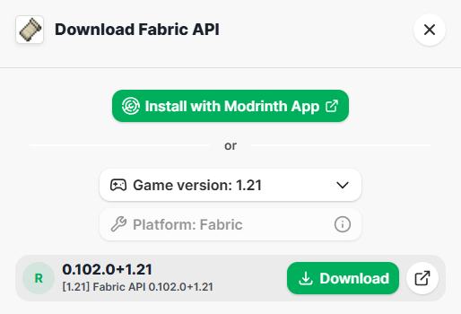

# EMIP — Embodied Multi-Party Interaction Platform

**Minecraftの世界で、人間とAIエージェントが話しながら一緒に活動するための研究プラットフォームです。**

複数の人間とAIエージェントが同じワールドに参加し、会話、移動、資源収集、アイテムの受け渡しなどを行えます。人間とAIが作業を分担したり、互いの状況を伝え合ったりする場面を構成できます。

## このREADMEで試すこと

同梱のAIエージェント**Sally**をMinecraftに参加させ、日本語で話しかけ、返答と移動を確認します。

Windowsで簡単に起動できるBATファイルを用意しています。ここでは、**Windows 11のPC 1台で、音声認識と音声合成を使う`asr_tts`モードを動かす手順**を説明します。Windows向けBATや、この音声認識を使う場合の条件は、下の表に分けて示しています。

| 順番 | 行うこと | 完了の目安 |
| --- | --- | --- |
| [1. 事前準備](#1-事前準備) | Docker、Minecraft、MOD、APIキーを用意する | FabricでMinecraftを起動できる |
| [2. サーバーの起動と参加](#2-サーバーの起動と参加) | サーバーと音声合成を起動し、Minecraftから参加する | ワールドに入り、マイクを設定できる |
| [3. Sallyの起動と会話](#3-sallyの起動と会話) | 接続先を設定し、Sallyを起動する | 話しかけてEnterを押すと返答がある |
| [4. 終了する](#4-終了する) | コンテナを停止する | ワールドを保存して終了できる |

2回目以降は[5. 次回の起動](#5-次回の起動)、途中で止まった場合は[6. うまく動かないとき](#6-うまく動かないとき)を参照してください。

> [!IMPORTANT]
> このサンプルでは、**話しかけた後、Sallyを起動したウィンドウでEnterキーを押す**と、返答や行動を生成します。Enterを押す場所は、後の手順で説明します。

## 1. 事前準備

### 用意するもの

| 基本の準備 | 内容 |
| --- | --- |
| PCとインターネット接続 | MinecraftとDockerの実行、ファイルの取得、LLMへの問い合わせに使用します。 |
| Docker実行環境 | サーバーやSallyを動かします。この手順ではDocker Desktopを使用します。 |
| Minecraft: Java Editionのライセンス | **Minecraft 1.21**を使用します。 |
| OpenAI APIキー | Sallyの返答・行動生成に使用します。同梱設定のモデルは`gpt-5.2`です。 |

| 起動方法・音声モードに応じた準備 | 必要になる場合 |
| --- | --- |
| **Windows** | 同梱のBATファイルをダブルクリックして起動する場合。このREADMEはWindows 11での操作を説明します。 |
| **NVIDIA GPUと対応ドライバー** | 同梱の音声認識（`asr_tts`モード）を使う場合。DockerからGPUを利用できる必要があります。 |
| **マイクとヘッドホンなどの音声出力機器** | 音声で会話する場合。 |

以下のDocker構成では、Python、Conda、Node.js、VOICEVOXアプリをPCへ個別にインストールする必要はありません。初回起動時に、必要な実行環境や音声認識モデルをダウンロードします。

### 1.1 Docker Desktopをインストールする

1. [Docker DesktopのWindows版ダウンロードページ](https://docs.docker.com/desktop/setup/install/windows-install/)を開き、PCに対応するインストーラーをダウンロードします。
2. インストーラーを実行します。バックエンドの選択が表示された場合は、**WSL 2**を使う設定にします。
3. インストーラーから再起動を求められた場合は、Windowsを再起動します。
4. スタートメニューから**Docker Desktop**を開き、起動が完了するまで待ちます。
5. スタートメニューから**PowerShell**を開き、次のコマンドを入力してEnterを押します。

```powershell
docker version
```

`Client`と`Server`の両方の情報が表示されれば、Dockerへ接続できています。`Server`の情報が出ず接続エラーになる場合は、Docker Desktopの起動状態を確認してください。

この手順で使う音声認識には、NVIDIA GPUを利用できるWSL 2の環境が必要です。[Docker公式のGPU設定手順](https://docs.docker.com/desktop/features/gpu/)に従い、NVIDIAドライバーとWSLを準備してください。WSLの更新を求められた場合は、PowerShellで`wsl --update`を実行します。

**ここまでの確認：Docker Desktopが起動し、`docker version`でServerの情報が表示される。**

### 1.2 MinecraftとFabricを用意する

このREADMEでは、公式のMinecraft Launcherを使う場合を説明します。Fabricは、MinecraftでMODを読み込むための仕組みです。

1. [Minecraft公式サイト](https://www.minecraft.net/ja-jp/download)からMinecraft Launcherをインストールし、Java Editionのライセンスを持つアカウントでログインします。
2. **Minecraft: Java Edition → 起動構成 → 新規作成**を開き、バージョンを**release 1.21**にして保存します。
3. 作成した起動構成で一度Minecraftを起動し、タイトル画面が表示されたら終了します。Minecraft Launcherも閉じます。
4. [Fabricのダウンロードページ](https://fabricmc.net/use/installer/)から、Windows用インストーラーをダウンロードして実行します。
5. 次の内容でインストールします。

| Fabricインストーラーの項目 | 選ぶ内容 |
| --- | --- |
| Client / Server | **Client** |
| Minecraft Version | **1.21** |
| Loader Version | **0.16.9以降** |
| Create Profile | チェックを入れる |

6. Minecraft Launcherを開き直し、起動構成の一覧から**fabric-loaderで始まる1.21用の構成**を選んで起動します。
7. タイトル画面が表示されたら、一度Minecraftを終了します。次にMODを配置します。

画面の例は[Fabric公式のWindows向け導入手順](https://docs.fabricmc.net/players/installing-fabric/windows)でも確認できます。

**ここまでの確認：Fabricの1.21用起動構成で、Minecraftのタイトル画面まで進める。**

### 1.3 EMIPをダウンロードする

1. このリポジトリのGitHubページで、**Code → Download ZIP**を選びます。
2. ダウンロードしたZIPを右クリックし、**すべて展開**します。
3. 展開先を開き、`docker-compose.yml`と`individual_launchers`が並んでいるフォルダを見つけます。以降、この場所を**EMIPフォルダ**と呼びます。

使用する主なファイルは次の位置にあります。

```text
EMIPフォルダ/
├─ docker-compose.yml
├─ docker-compose.override.yml
├─ individual_launchers/
│  ├─ start_minecraft_environment.bat  ← サーバーと音声合成の起動
│  ├─ start_sally_agent.bat            ← Sallyの起動
│  └─ start_VOICEVOX.bat               ← 音声合成だけを起動するとき
├─ minecraft_server_on_docker/
│  └─ DEVELOP/                        ← 同梱のサーバー用MOD
└─ src/
   └─ runtime_settings.py             ← 実行設定
```

ZIPの中から直接起動せず、展開したファイルを使います。`docker-compose.override.yml`と`minecraft_server_on_docker/DEVELOP`は、同梱の観測用MODを読み込むために使うので、そのまま残してください。

### 1.4 MinecraftクライアントにMODを入れる

**クライアント**は、自分が画面を見て操作するMinecraftです。以下の3種類のMODを、そのMinecraftへ入れます。

| MOD | ダウンロードするファイル | 役割 |
| --- | --- | --- |
| [Fabric API](https://modrinth.com/mod/fabric-api/version/0.102.0%2B1.21) | `fabric-api-0.102.0+1.21.jar` | MODが使う共通機能 |
| [Simple Voice Chat](https://modrinth.com/mod/simple-voice-chat/version/fabric-1.21.1-2.6.17) | `voicechat-fabric-1.21.1-2.6.17.jar` | Minecraft内の音声会話。この版はMinecraft 1.21にも対応します。 |
| [Easy LLM Voice](https://modrinth.com/mod/easy-llm-voice) | `easy-llm-voice-fabric-1.0.0+mc1.21.jar` | Sallyと音声をやり取りするための接続設定 |

Fabric APIのダウンロード画面では、**Game version: 1.21 / Platform: Fabric**を選びます。次は選択画面の例です。



ダウンロードが終わったら、次の順に配置します。

1. Minecraftを終了します。
2. エクスプローラーを開き、上部のアドレス欄に次を貼り付けてEnterを押します。

```text
%APPDATA%\.minecraft
```

3. `mods`フォルダを開きます。なければ、右クリックの**新規作成 → フォルダー**で`mods`という名前のフォルダを作ります。
4. ダウンロードした3つの`.jar`ファイルを、その中へコピーします。`.jar`は展開せず、そのまま置きます。

```text
.minecraft/
└─ mods/
   ├─ fabric-api-0.102.0+1.21.jar
   ├─ voicechat-fabric-1.21.1-2.6.17.jar
   └─ easy-llm-voice-fabric-1.0.0+mc1.21.jar
```

Minecraft Launcherの起動構成で**ゲームディレクトリ**を変更している場合は、そのディレクトリの`mods`フォルダへ入れてください。詳しくは[Fabric公式のMOD配置手順](https://docs.fabricmc.net/players/installing-mods)を参照できます。

> [!NOTE]
> この作業は、自分が操作するMinecraftへのMOD導入です。**EMIPのサーバー側のMODは、起動用BATが用意します。** 同梱のEasy LLM（観測用MOD）はサーバー用です。

Easy LLM Voiceはサーバーとクライアントで同じバージョンを使います。サーバー側のファイルは、初回のサーバー起動後に`EMIPフォルダ/minecraft_server_on_docker/flat/25565/data/mods/`で確認できます。異なる場合は、クライアント側を同じ版へ揃えてMinecraftを再起動してください。

**ここまでの確認：3種類のMODを入れた状態で、FabricのMinecraft 1.21を起動できる。**

### 1.5 OpenAI APIキーを登録する

Sallyは、Minecraftの状況や依頼の内容をもとに、OpenAI APIを使って返答・行動を生成します。標準設定の`gpt-5.2`をAPIで利用できるアカウントとキーを用意してください。

APIの利用料金はChatGPTの契約とは別に管理されます。[OpenAI公式のAPI請求設定の説明](https://help.openai.com/en/articles/9039756-managing-billing-for-chatgpt-and-the-api-platform)を確認し、利用するAPIアカウントの支払設定やクレジット残高を準備してください。

1. [OpenAI PlatformのAPIキー画面](https://platform.openai.com/api-keys)にログインし、APIキーを作成します。キーの確認・管理方法は[OpenAI公式の説明](https://help.openai.com/en/articles/4936850-where-do-i-find-my-openai-api-key)を参照してください。
2. Windowsのスタートメニューで「環境変数」を検索し、**環境変数を編集**を開きます。「システム環境変数の編集」が開いた場合は、続けて**環境変数**を選びます。
3. **ユーザー環境変数**の**新規**を押し、次を登録します。同名の変数が既にある場合は、**編集**で値を更新します。

| 項目 | 登録内容 |
| --- | --- |
| 変数名 | `OPENAI_API_KEY` |
| 変数値 | 作成したAPIキー |

4. **OK**で設定画面を閉じます。
5. 起動用BATに設定を反映するため、Windowsを再起動します。

キーはソースコードへ書き込まず、この環境変数から読み込みます。API利用には料金が発生し、会話の文字起こしやゲーム内の観測情報などがOpenAI APIへ送られます。

**ここまでで、初回の準備は完了です。次はサーバーを起動します。**

## 2. サーバーの起動と参加

### 2.1 サーバーと音声合成を起動する

1. スタートメニューから**Docker Desktop**を起動し、準備が完了するまで待ちます。
2. エクスプローラーで**EMIPフォルダ → individual_launchers**を開きます。
3. **start_minecraft_environment.bat**をダブルクリックします。

このBATで、次の3つが起動します。

| サービス | Docker Desktopに表示されるコンテナ名 | 役割 |
| --- | --- | --- |
| Minecraftサーバー | `mc_server_flat_25565` | 自分とSallyが参加するワールド |
| Mineflayer | `beliefnestjs` | Sallyのゲーム内操作 |
| VOICEVOX | `voicevox_engine` | Sallyの返答を音声にする |

起動中は、サーバーのウィンドウと、別に開く`voicevox`ウィンドウを残しておきます。初回はダウンロード・ビルドがあるため、時間がかかります。

> [!NOTE]
> **サーバー用BATでVOICEVOXも起動します。** 通常の起動では`start_VOICEVOX.bat`を別に実行する必要はありません。VOICEVOXが既に起動中なら、そのコンテナを使用します。

同梱のサーバー設定はMinecraftの接続者認証を無効にしています。手元のPCまたは信頼できるネットワーク内で使用してください。

### 2.2 起動が完了したことを確認する

Docker Desktopの**Containers**を開き、コンテナ名をクリックして**Logs**を確認します。グループにまとめて表示される場合は、グループを展開してください。

| 確認するコンテナ | ログに表示される起動完了の目印 |
| --- | --- |
| `mc_server_flat_25565` | `Done`を含むメッセージ |
| `beliefnestjs` | `Server started on port 3000` |
| `voicevox_engine` | `Application startup complete` |

Minecraftサーバーのログは、例えば次のように表示されます。時刻と秒数は実行ごとに異なります。

```text
[00:39:28] [Server thread/INFO]: Done (0.465s)! For help, type "help"
```

VOICEVOXのログは、別に開いた`voicevox`ウィンドウでも確認できます。

```text
INFO:     Application startup complete.
```

サーバー用BATのウィンドウに過去のログが表示されない場合も、Docker Desktopの**Logs**から確認できます。

**ここまでの確認：3つのコンテナが稼働し、それぞれの起動完了ログが出ている。**

### 2.3 Minecraftからワールドへ参加する

1. Minecraft Launcherで、MODを入れた**Fabricの1.21用起動構成**を選んで起動します。
2. タイトル画面で**マルチプレイ → サーバーを追加**を選びます。
3. 次の内容を入力して**完了**を押します。

| 項目 | 入力する値 |
| --- | --- |
| サーバー名 | `EMIP`（自分が分かる名前で構いません） |
| サーバーアドレス | `localhost:25565` |

4. 一覧の`EMIP`を選び、**サーバーに接続**を押します。

このアドレスは、Minecraftとサーバーを同じPCで動かす場合のものです。

初回の試用では、後で位置調整のコマンドを使えるよう、自分のプレイヤーへ管理者権限（op）を付けます。**start_minecraft_environment.batで開いたサーバーのウィンドウ**をクリックし、次を入力してEnterを押してください。

```text
op YourName
```

`YourName`は、自分のMinecraftのプレイヤー名に置き換えます。サーバーのウィンドウに入力する場合、先頭の`/`は不要です。同じワールドで次回も利用する場合、権限を付け直す必要はありません。

**ここまでの確認：ワールド内を歩ける。まだSallyがいなくても正常です。**

### 2.4 自分のマイクと音声出力を設定する

Minecraft内で**Simple Voice Chat**の設定画面を開きます。標準のキーは`V`です。

1. 使用するマイクと、ヘッドホン・スピーカーを選びます。
2. 発話方式を選びます。**Push to Talk**では、指定したキーを押している間の声が送られます。**Voice Activation**では、声を検出すると送られます。
3. マイクテストで入力を確認し、設定を完了します。

初回設定の画面は[Simple Voice Chat公式の説明](https://modrepo.de/minecraft/voicechat/wiki/client_setup)を参照できます。

`V`で別の画面が開く場合は、**Esc → 設定 → 操作設定 → キー割り当て**で、Simple Voice Chatの画面を開くキーを確認してください。Easy LLM Voiceも同じキーを使う場合があるため、それぞれ別のキーに割り当てます。

**ここまでの確認：Simple Voice Chatでマイク入力を確認でき、発話に使うキー・方式が分かる。**

## 3. Sallyの起動と会話

### 3.1 Sallyが観測する場所を設定する

Sallyは、設定された範囲内の情報をもとに周囲を把握します。初回は**自分が試す場所の座標と、Sallyの観測範囲を合わせます。**

1. Minecraft内で、会話や移動を試す場所に立ちます。
2. `F3`を押し、画面の`XYZ`で現在のX・Y・Z座標を確認します。Yは高さです。
3. エクスプローラーで**EMIPフォルダ → src**を開きます。
4. `runtime_settings.py`を右クリックし、**プログラムから開く → メモ帳**などで開きます。ファイルを実行する操作は不要です。
5. `Ctrl + F`で`MINECRAFT_WORLD_CFG`を検索します。

最初は、次のようになっています。

```python
MINECRAFT_WORLD_CFG = MinecraftWorldConfig(
    env_box=[[-20, -2, -20], [20, 10, 20]],
    visibility_distance=20.0,
)
```

`env_box`の値は、次の順番です。

```text
[[最小X, 最小Y, 最小Z], [最大X, 最大Y, 最大Z]]
```

自分が立っている場所と、その周囲の地面・移動先が入る範囲にします。標準ではX・Zが-20～20、Yが-2～10です。

| 試す場所の例 | `env_box`の設定例 |
| --- | --- |
| X=0、Y=4、Z=0付近 | `[[-20, -2, -20], [20, 10, 20]]`（標準のまま） |
| X=0、Y=-60、Z=0付近 | `[[-20, -64, -20], [20, -40, 20]]` |
| X=100、Y=64、Z=100付近 | `[[80, 60, 80], [120, 84, 120]]` |

例えばY=-60付近で試す場合は、`env_box`の行を次のように変更します。

```python
    env_box=[[-20, -64, -20], [20, -40, 20]],
```

6. 必要な変更をして、`Ctrl + S`で保存します。拡張子は`.py`のままにしてください。

観測する領域を広げると処理が重くなるため、最初は試す場所の周囲に絞ります。`visibility_distance`はSallyからの視認距離で、標準は20ブロックです。

この手順では、同じファイルにある次の設定を使用します。ダウンロードした標準設定のままであれば、変更は不要です。

```python
DECISION_MODE = DECISION_MODE_LIST[0]  # Enterで返答・行動を開始
VOICE_MODE = VOICE_MODE_LIST[1]        # 音声認識と音声合成を使用
```

### 3.2 Sallyの音声接続先を登録する

**Easy LLM Voiceの設定画面で、Sallyと音声をやり取りするための接続先を登録します。** マイク設定に続けて、Minecraftのワールドへ参加した状態で操作してください。
注意:設定するには、op権限が必要となります。Minecraf sever のターミナルに```op プレイヤー名``` を入力し、op権限を付与した状態で作業して下さい。

| 設定するMOD | この手順で設定するもの |
| --- | --- |
| Simple Voice Chat | 自分のマイク、ヘッドホン・スピーカー、発話方式。設定方法は[2.4](#24-自分のマイクと音声出力を設定する)を参照してください。 |
| Easy LLM Voice | 音声を結び付けるAIエージェントの名前と接続先。以下の手順でSallyを登録します。 |

#### 3.2.1 設定画面を開く

1. Minecraftで**Esc → 設定 → 操作設定 → キー割り当て**を開きます。
2. **Easy LLM Voiceの接続設定画面を開く項目**を探し、割り当てられているキーを確認します。公開MODの標準キーは`V`です。
3. Simple Voice Chatと同じキーになっている場合は、Easy LLM Voiceの項目を選び、空いているキーへ変更します。例えば`B`が未使用なら、`B`へ割り当てます。
4. ワールドへ戻り、割り当てたキーを押します。
5. **「新規接続先の入力」**と**「接続先一覧」**がある画面が開くことを確認します。

Easy LLM Voiceの項目がキー割り当てに見つからない場合は、[1.4 MinecraftクライアントにMODを入れる](#14-minecraftクライアントにmodを入れる)を確認してください。画面を操作するMinecraftクライアントにも、`easy-llm-voice-fabric-1.0.0+mc1.21.jar`が必要です。

#### 3.2.2 Sallyの接続先を追加する

画面上部の**「新規接続先の入力」**に、次の値を入力します。半角で入力してください。

| 画面の項目 | 入力する値 | この設定の意味 |
| --- | --- | --- |
| プレイヤー名 / player name | `sally` | 音声を結び付けるSallyのMinecraftプレイヤー名 |
| ホスト / host | `emip-sally` | Sallyの起動用BATが作成するDockerコンテナの名前 |
| ポート / port | `8765` | Sallyが音声接続を受け付けるポート |

この構成では、MinecraftサーバーからDocker内のSallyへ接続するため、ホストに`emip-sally`を使います。Sallyの起動用BATと音声の接続設定を変更していなければ、表の値をそのまま使えます。

1. **「接続を有効化」**が**「オン」**になっていることを確認します。「オフ」なら、そのボタンを押して「オン」にします。
2. **「追加 / Add」**を押します。
3. **「接続先一覧」**に、次のような行が追加されたことを確認します。

```text
sally @ emip-sally:8765 [ON]
```

4. 追加された行をクリックし、下の**「選択中の接続先」**に、入力した名前・ホスト・ポートが表示されることを確認します。下部が見えない場合は、画面内をスクロールします。

```text
player: sally
host: emip-sally
port: 8765
connected: False
```

すでに同じ接続先が登録されている場合は、その行を選んで設定を確認します。値を間違えた場合は、誤った行を選んで**「削除」**し、正しい値で追加し直してください。

> [!NOTE]
> **`[ON]`は接続先を有効にした状態、`connected: True`は実際につながった状態です。** この段階ではSallyをまだ起動していないため、`connected: False`でも構いません。

**ここまでの確認：`sally @ emip-sally:8765 [ON]`が一覧に表示され、選択すると設定内容を確認できる。**

#### 3.2.3 Sallyの起動後に接続を確認する

1. **「閉じる」**で設定画面を閉じ、Minecraftはワールドに参加したままにします。
2. 次の[3.3 Sallyを起動する](#33-sallyを起動する)へ進み、`start_sally_agent.bat`でSallyを起動します。
3. MinecraftにSallyが参加したら、Easy LLM Voiceの設定画面を再度開きます。
4. 接続先一覧で`sally`の行を選び、**「選択中の接続先」**に`connected: True`と表示されることを確認します。
5. 表示が更新されない場合は、**「再読込 / Reload」**を押すか、設定画面を開き直します。

接続を確認できたら、[3.4 最初の会話をする](#34-最初の会話をする)へ進みます。Sallyからの返答を生成するには、話しかけた後にSallyのウィンドウでEnterを押します。

#### 3.2.4 接続できない場合

| 状況 | 確認すること |
| --- | --- |
| 設定画面を開けない | クライアント側のEasy LLM Voiceの導入と、キーの重複を確認します。 |
| 一覧に`[OFF]`と表示される | その接続先を選択して削除し、「接続を有効化：オン」で追加し直します。 |
| Sallyの起動後も`connected: False`のまま | `player: sally`、`host: emip-sally`、`port: 8765`を確認し、「再読込」を押します。Docker Desktopで`emip-sally`が起動しているかも確認します。 |
| 接続待ちのままタイムアウトした | Minecraftへの参加と接続先の登録・有効化を済ませてから、`start_sally_agent.bat`でSallyを起動し直します。 |
| `connected: True`だが会話できない | 接続後は、Simple Voice Chatのマイク・発話方式、VOICEVOXの起動、Sallyとの距離、SallyのウィンドウでのEnter入力を確認します。 |

画面の各項目と操作は、[Easy LLM Voiceの説明ページ](https://modrinth.com/mod/easy-llm-voice)でも確認できます。このREADMEの起動構成では、接続先に上記の`sally` / `emip-sally` / `8765`を使用してください。

### 3.3 Sallyを起動する

1. Minecraftはワールドに参加したままにします。
2. エクスプローラーで**EMIPフォルダ → individual_launchers**を開きます。
3. **start_sally_agent.bat**をダブルクリックします。
4. 初回は実行環境のビルドがあるので、処理が終わるまで待ちます。

Sallyの起動ウィンドウに、次が表示されることを確認します。

```text
[enter: sally acts]:
```

この入力待ちが表示されるウィンドウを、以降**Sallyのウィンドウ**と呼びます。

| 確認する場所 | 起動後の状態 |
| --- | --- |
| Minecraft | プレイヤー名`sally`が参加する。`Tab`キーのプレイヤー一覧でも確認できます。 |
| Easy LLM Voiceの設定画面 | Sallyの接続先を選ぶと`connected: True`になる。表示が更新されない場合は`Reload`を押すか、画面を開き直す。 |
| Sallyのウィンドウ | `[enter: sally acts]:`と表示される。 |

現在のプログラムではSallyに必要な管理者権限を参加時に付与するため、手動で`op sally`を入力する作業は不要です。

Sallyが遠くにいる場合は、**Minecraftのチャット**を`T`キーで開き、次のように入力して、自分が設定した観測範囲内へ呼び寄せられます。`YourName`は自分のプレイヤー名に置き換えてください。

```text
/tp sally YourName
```

**ここまでの確認：Sallyが近くにいて、音声接続が`True`になり、SallyのウィンドウがEnter入力を待っている。**

### 3.4 最初の会話をする

1. MinecraftでSallyの近くに立ちます。
2. マイクで**「Sally、こんにちは。今いる座標を教えて」**と話します。Push to Talkの場合は、発話キーを押しながら話してください。
3. 話し終わって少し待ち、`Alt + Tab`などで**Sallyのウィンドウ**へ切り替えます。
4. **Enterキーを1回押します。**
5. Minecraftへ戻り、チャットと音声の返答を待ちます。

> [!TIP]
> **話す → SallyのウィンドウでEnter → Minecraftで返答を確認する**、が基本の操作です。Minecraftのチャット送信用Enterと、Sallyへ行動を指示するEnterは、操作するウィンドウが異なります。

SallyはLLMへ問い合わせてから返答・行動を生成するため、応答まで時間がかかります。最初はEnterを連打せず、一つの依頼の結果を待ってください。

音声入力を確認しにくい場合は、Minecraftのチャットに同じ依頼を入力し、その後でSallyのウィンドウのEnterを押して試せます。

**Sallyからチャットと音声で返答があれば、最初の会話は成功です。**

### 3.5 移動を頼む

Sallyから数ブロック離れた、障害物のない場所へ移動し、次のように話しかけます。

> Sally、私の近くまで来て。

SallyのウィンドウでEnterを1回押し、Minecraftへ戻って移動を確認します。設定した観測範囲内で、Sallyから自分が見える場所で試してください。

その後は、原木や道具を用意して「この原木を集めて」「持っているアイテムを教えて」などを試せます。採掘や製作には、対象のブロック、必要な道具・材料、到達可能な経路が必要です。返答や行動は、LLMとワールドの状況によって変わります。

このサンプルは、実行中の行動を新しい依頼で中断しません。最初は、短い依頼を一つずつ試してください。

## 4. 終了する

Docker Desktopの**Containers**画面で、次の順に停止します。停止には**■ボタン**を使います。

| 順番 | 操作 |
| --- | --- |
| 1 | `emip-sally`を停止する。 |
| 2 | Minecraftのメニューからサーバーを退出する。 |
| 3 | `voicevox_engine`を停止する。 |
| 4 | `beliefnestjs`を停止する。 |
| 5 | `mc_server_flat_25565`を停止する。 |

停止を確認してから、BATで開いたウィンドウを閉じます。SallyとVOICEVOXのコンテナは、停止すると一覧から消えることがあります。

ワールドは`EMIPフォルダ/minecraft_server_on_docker/flat/25565/data/`に保存されます。同じEMIPフォルダを使えば、次回もそのワールドを利用できます。

## 5. 次回の起動

初回準備が終わっていれば、次の操作で再開できます。

1. **Docker Desktop**を起動する。
2. **start_minecraft_environment.bat**を実行し、Minecraftサーバー・Mineflayer・VOICEVOXの起動完了を確認する。
3. **FabricのMinecraft 1.21**を起動し、登録したサーバー`EMIP`へ参加する。
4. Easy LLM Voiceで、Sallyの接続先が登録され、有効になっていることを確認する。
5. **start_sally_agent.bat**を実行する。
6. Sallyの参加と`connected: True`を確認し、話しかけてSallyのウィンドウでEnterを押す。

APIキー、MOD、音声接続先を変更していなければ、登録し直す必要はありません。別の場所で試すときは、[3.1 観測範囲の設定](#31-sallyが観測する場所を設定する)を確認します。

## 6. うまく動かないとき

### 導入・起動で止まる

| 症状 | 確認すること |
| --- | --- |
| `docker`が見つからない・Dockerへ接続できない | Docker Desktopのインストールと起動を確認し、PowerShellを開き直して`docker version`を実行します。 |
| GPU・CUDA関連のエラーが出る | `asr_tts`の音声認識を使う場合は、NVIDIAドライバー、WSL 2、DockerからのGPU利用を確認します。[公式のGPU設定手順](https://docs.docker.com/desktop/features/gpu/)も参照してください。 |
| Minecraftが起動時にMODのエラーを表示する | Minecraft 1.21用・Fabric用のファイルを選んだか、同じMODの異なる版が重複していないか確認します。 |
| コンテナ名やポートが使用中と表示される | Docker Desktopで以前の起動分を確認し、同じEMIP環境の該当コンテナを停止してから再実行します。 |
| 初回のダウンロード・ビルドが長い | 起動ウィンドウで処理が進んでいるか確認します。エラーで停止している場合は、最後のメッセージを確認してください。 |
| Minecraftサーバーは起動したがVOICEVOXが起動していない | `voicevox`ウィンドウか`voicevox_engine`のログを確認します。原因を解消後、`individual_launchers/start_VOICEVOX.bat`で音声合成だけを起動できます。 |

### 参加・音声・行動を確認する

| 症状 | 確認すること |
| --- | --- |
| ワールドへ参加できない | Minecraft 1.21のFabric構成、サーバーの`Done`ログ、接続先`localhost:25565`を確認します。 |
| Simple Voice Chat / Easy LLM Voiceの画面を開けない | クライアント側のMOD配置と、Minecraftのキー割り当てを確認します。 |
| Sallyが参加しても、音声接続が`False`のまま・タイムアウトする | 接続先の`sally` / `emip-sally` / `8765`と有効状態を確認します。Minecraftへの参加と接続先登録を済ませてから、Sallyを起動し直します。 |
| 話しかけても返答がない | **SallyのウィンドウでEnterを押したか**、マイクがミュートでないか、Push to Talkのキーを押していたかを確認します。チャット入力でも試してください。 |
| チャットは返るが声が聞こえない | VOICEVOXの起動、`connected: True`、ヘッドホン・スピーカーの選択と音量、Sallyとの距離を確認します。 |
| APIキー・モデル・利用上限のエラーが出る | 環境変数`OPENAI_API_KEY`の登録、`gpt-5.2`のAPI利用権限、APIの利用設定を確認します。キー変更後はSallyを起動し直してください。 |
| 周囲を認識しない・移動や採掘に失敗する | F3の座標と`env_box`、視認距離、障害物、対象や道具の有無を確認します。設定変更後はSallyを起動し直します。 |

### ログを確認する

Sallyの実行ごとに、`EMIPフォルダ/src/logs/`に日時の付いたフォルダが作られます。直近のフォルダを開いて確認してください。

| ファイル | 記録する内容 |
| --- | --- |
| `sally.log` | Sallyの処理状況や行動 |
| `llm_..._prompt.txt` / `llm_..._response.txt` | LLMへ渡した内容と返答 |
| `asr.log` / `tts.log` | 音声認識・音声合成 |

Sallyの起動中は、ブラウザで[観測モニター](http://localhost:8000)を開き、観測情報の受信・処理状況も確認できます。

不具合を報告するときは、止まった手順の番号、表示されたエラー、MinecraftとMODのバージョンを添えてください。ログには会話やワールドの情報が含まれるため、共有する範囲を確認し、APIキーは貼り付けないでください。

### 音声認識を使わない構成にする場合

ここまでの手順は`asr_tts`用です。音声を使わないモードなどへ変更してGPUなしで動かす場合は、音声モードに加え、`docker-compose.yml`の`python_runtime`にある`gpus: all`も外してください。同梱のDocker設定は、GPUを割り当てる構成になっています。

VOICEVOXの起動用BATはGPUの有無によってCPU版・GPU版を選びます。VOICEVOXがCPUで動く場合も、同梱の`asr_tts`の音声認識にはNVIDIA GPUが必要です。

## ライセンス・利用ソフトウェア

本リポジトリのコードはMITライセンスで提供します。詳細は[LICENSE](./LICENSE)を参照してください。Minecraft、MOD、音声合成などの外部ソフトウェアには、それぞれの利用条件が適用されます。

標準構成の音声合成には[VOICEVOX](https://voicevox.hiroshiba.jp/)を使用します。音声を含む動画などを公開する際は、[VOICEVOXの利用規約](https://voicevox.hiroshiba.jp/term/)と、使用する話者の利用条件・クレジット表記も確認してください。

## Credits

- RealtimeSTT by Kolja Beigel
  <br>GitHub: [https://github.com/KoljaB/RealtimeSTT](https://github.com/KoljaB/RealtimeSTT)

- Simple Voice Chat by Max Henkel / henkelmax
  <br>Official site: [https://modrepo.de/minecraft/voicechat](https://modrepo.de/minecraft/voicechat)
  <br>Modrinth: [https://modrinth.com/plugin/simple-voice-chat](https://modrinth.com/plugin/simple-voice-chat)

- Voyager (MineDojo)
  <br>GitHub: [https://github.com/MineDojo/Voyager](https://github.com/MineDojo/Voyager)
  <br>コードの一部はVoyagerを改変して使用しています。

Simple Voice Chat itself is not distributed as part of this project.
