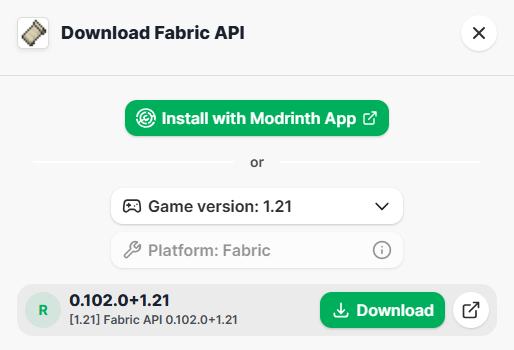

# EMIP — Embodied Multi-Party Interaction Platform

[日本語版 / Japanese](./README.ja.md)

**A research platform where humans and AI agents talk and work together in Minecraft.**

Multiple humans and AI agents can join the same world to talk, move around, gather resources, and exchange items. You can use the platform to create situations where humans and AI share tasks and keep each other informed about what they are doing.

## What you will try

You will bring the included AI agent, **Sally**, into Minecraft, speak to her in Japanese, and check that she can respond and move.

The project includes BAT files for easy startup on Windows. This guide explains **how to run `asr_tts` mode, which uses speech recognition and speech synthesis, on a single Windows 11 PC**. Requirements specific to the Windows BAT files or this speech recognition setup are listed separately below.

| Step | What to do | How to check it worked |
| --- | --- | --- |
| [1. Prepare your environment](#1-prepare-your-environment) | Set up Docker, Minecraft, mods, and an API key | You can launch Minecraft with Fabric |
| [2. Start the server and join](#2-start-the-server-and-join) | Start the server and speech synthesis, then join from Minecraft | You can enter the world and set up your microphone |
| [3. Start Sally and talk](#3-start-sally-and-talk) | Configure the voice connection and start Sally | Sally responds after you speak and press Enter |
| [4. Shut down](#4-shut-down) | Stop the containers | You can save the world and exit |

For later sessions, see [5. Start your next session](#5-start-your-next-session). If you get stuck, see [6. Troubleshooting](#6-troubleshooting).

> [!IMPORTANT]
> In this sample, Sally generates a response or action when you **press Enter in the window used to start Sally after speaking**. The steps below explain which window to use.

## 1. Prepare your environment

### What you need

| Basic requirement | Details |
| --- | --- |
| A PC and an internet connection | Used to run Minecraft and Docker, download files, and send requests to the LLM. |
| A Docker runtime | Runs the server and Sally. This guide uses Docker Desktop. |
| A Minecraft: Java Edition license | This guide uses **Minecraft 1.21**. |
| An OpenAI API key | Used to generate Sally's responses and actions. The included configuration uses `gpt-5.2`. |

| Requirement for a particular startup method or voice mode | When it is needed |
| --- | --- |
| **Windows** | When you launch the project by double-clicking the included BAT files. This guide describes the steps on Windows 11. |
| **An NVIDIA GPU and compatible drivers** | When you use the included speech recognition setup (`asr_tts` mode). Docker must be able to access the GPU. |
| **A microphone and headphones or another audio output device** | When you want to use voice conversation. |

With the Docker setup below, you do not need to install Python, Conda, Node.js, or the VOICEVOX desktop app separately on your PC. The required runtime environments and speech recognition model are downloaded during the first startup.

### 1.1 Install Docker Desktop

1. Open the [Docker Desktop installation page for Windows](https://docs.docker.com/desktop/setup/install/windows-install/) and download the installer for your PC.
2. Run the installer. If you are asked to select a backend, choose **WSL 2**.
3. Restart Windows if the installer asks you to.
4. Open **Docker Desktop** from the Start menu and wait for it to finish starting.
5. Open **PowerShell** from the Start menu, enter the following command, and press Enter.

```powershell
docker version
```

If information for both `Client` and `Server` appears, you can connect to Docker. If the `Server` information is missing and you see a connection error, check that Docker Desktop has finished starting.

The speech recognition setup used in this guide requires a WSL 2 environment with access to an NVIDIA GPU. Follow the [official Docker GPU setup instructions](https://docs.docker.com/desktop/features/gpu/) to prepare your NVIDIA drivers and WSL. If you are asked to update WSL, run `wsl --update` in PowerShell.

**Checkpoint: Docker Desktop is running, and `docker version` displays Server information.**

### 1.2 Set up Minecraft and Fabric

This guide uses the official Minecraft Launcher. Fabric allows Minecraft to load mods.

1. Install Minecraft Launcher from the [official Minecraft website](https://www.minecraft.net/ja-jp/download) and sign in with an account that has a Java Edition license.
2. Open **Minecraft: Java Edition → Installations → New installation**, select **release 1.21** as the version, and save the installation.
3. Launch Minecraft once with that installation. When the title screen appears, close Minecraft and Minecraft Launcher.
4. Download and run the Windows installer from the [Fabric download page](https://fabricmc.net/use/installer/).
5. Install Fabric with the following settings.

| Fabric installer field | Select |
| --- | --- |
| Client / Server | **Client** |
| Minecraft Version | **1.21** |
| Loader Version | **0.16.9 or later** |
| Create Profile | Enable the checkbox |

6. Reopen Minecraft Launcher. From the installation list, select the **1.21 installation whose name starts with fabric-loader**, then launch it.
7. Once the title screen appears, close Minecraft. You will install the mods next.

For screenshots, see the [official Fabric installation guide for Windows](https://docs.fabricmc.net/players/installing-fabric/windows).

**Checkpoint: You can reach the Minecraft title screen using the Fabric installation for 1.21.**

### 1.3 Download EMIP

1. On this repository's GitHub page, select **Code → Download ZIP**.
2. Right-click the downloaded ZIP file and select **Extract All**.
3. Open the extracted files and find the folder containing both `docker-compose.yml` and `individual_launchers`. This guide calls it the **EMIP folder**.

The main files used in this guide are located here:

```text
EMIP folder/
├─ docker-compose.yml
├─ docker-compose.override.yml
├─ individual_launchers/
│  ├─ start_minecraft_environment.bat  ← Starts the server and speech synthesis
│  ├─ start_sally_agent.bat            ← Starts Sally
│  └─ start_VOICEVOX.bat               ← Starts speech synthesis on its own
├─ minecraft_server_on_docker/
│  └─ DEVELOP/                        ← Included server mods
└─ src/
   └─ runtime_settings.py             ← Runtime settings
```

Use the extracted files; do not launch them from inside the ZIP. Keep `docker-compose.override.yml` and `minecraft_server_on_docker/DEVELOP` in place, as they are used to load the included observation mod.

### 1.4 Install mods in your Minecraft client

The **client** is the Minecraft application you see and control on your screen. Install the following three mods in that application.

| Mod | File to download | Purpose |
| --- | --- | --- |
| [Fabric API](https://modrinth.com/mod/fabric-api/version/0.102.0%2B1.21) | `fabric-api-0.102.0+1.21.jar` | Shared functionality used by mods |
| [Simple Voice Chat](https://modrinth.com/mod/simple-voice-chat/version/fabric-1.21.1-2.6.17) | `voicechat-fabric-1.21.1-2.6.17.jar` | Voice chat in Minecraft. This version also supports Minecraft 1.21. |
| [Easy LLM Voice](https://modrinth.com/mod/easy-llm-voice) | `easy-llm-voice-fabric-1.0.0+mc1.21.jar` | Connection settings for exchanging audio with Sally |

On the Fabric API download page, select **Game version: 1.21 / Platform: Fabric**. The following screenshot shows an example.



After downloading the files, install them as follows:

1. Close Minecraft.
2. Open File Explorer, paste the following path into the address bar at the top, and press Enter.

```text
%APPDATA%\.minecraft
```

3. Open the `mods` folder. If it does not exist, right-click, select **New → Folder**, and name it `mods`.
4. Copy the three downloaded `.jar` files into that folder. Keep the `.jar` files as they are; do not extract them.

```text
.minecraft/
└─ mods/
   ├─ fabric-api-0.102.0+1.21.jar
   ├─ voicechat-fabric-1.21.1-2.6.17.jar
   └─ easy-llm-voice-fabric-1.0.0+mc1.21.jar
```

If you changed the **Game Directory** in your Minecraft Launcher installation settings, use the `mods` folder in that directory instead. See the [official Fabric mod installation guide](https://docs.fabricmc.net/players/installing-mods) for details.

> [!NOTE]
> These steps install mods in the Minecraft application you control. **EMIP's startup BAT file prepares the server mods.** The included Easy LLM observation mod is a server mod.

Use the same version of Easy LLM Voice on the server and client. After starting the server for the first time, you can check its files in `EMIP folder/minecraft_server_on_docker/flat/25565/data/mods/`. If the versions differ, update the client to match the server and restart Minecraft.

**Checkpoint: You can launch Minecraft 1.21 with Fabric and all three mods installed.**

### 1.5 Register your OpenAI API key

Sally uses the OpenAI API to generate responses and actions based on the Minecraft world and your requests. You need an API account and key with access to `gpt-5.2`, the model used in the default configuration.

API billing is managed separately from your ChatGPT subscription. Check the [official OpenAI billing guide](https://help.openai.com/en/articles/9039756-managing-billing-for-chatgpt-and-the-api-platform) and prepare the payment settings or credit balance for the API account you will use.

1. Sign in to the [OpenAI Platform API keys page](https://platform.openai.com/api-keys) and create an API key. See the [official OpenAI instructions](https://help.openai.com/en/articles/4936850-where-do-i-find-my-openai-api-key) for finding and managing keys.
2. Search for "environment variables" in the Windows Start menu and open **Edit environment variables for your account**. If you open **Edit the system environment variables** instead, select **Environment Variables** in the window that appears.
3. Under **User variables**, select **New** and enter the following values. If the variable already exists, select **Edit** to update its value.

| Field | Value |
| --- | --- |
| Variable name | `OPENAI_API_KEY` |
| Variable value | The API key you created |

4. Select **OK** to close the settings dialogs.
5. Restart Windows so that the startup BAT files can read the updated setting.

The key is read from this environment variable; do not put it in the source code. API usage incurs charges, and data such as conversation transcripts and observations from the game is sent to the OpenAI API.

**Initial setup is complete. Next, start the server.**

## 2. Start the server and join

### 2.1 Start the server and speech synthesis

1. Open **Docker Desktop** from the Start menu and wait for it to be ready.
2. In File Explorer, open **EMIP folder → individual_launchers**.
3. Double-click **start_minecraft_environment.bat**.

This BAT file starts three services:

| Service | Container name in Docker Desktop | Purpose |
| --- | --- | --- |
| Minecraft server | `mc_server_flat_25565` | The world that you and Sally join |
| Mineflayer | `beliefnestjs` | Sally's in-game controls |
| VOICEVOX | `voicevox_engine` | Converts Sally's responses into speech |

Keep the server window and the separate `voicevox` window open while the services are running. The first startup takes time because files must be downloaded and runtime environments built.

> [!NOTE]
> **The server BAT file also starts VOICEVOX.** You do not normally need to run `start_VOICEVOX.bat` separately. If VOICEVOX is already running, its existing container is used.

The included server configuration disables Minecraft player authentication. Use it on your own PC or within a trusted network.

### 2.2 Check that startup has completed

Open **Containers** in Docker Desktop, click a container name, and check its **Logs**. If the containers are displayed as a group, expand the group first.

| Container to check | Startup completion message in the logs |
| --- | --- |
| `mc_server_flat_25565` | A message containing `Done` |
| `beliefnestjs` | `Server started on port 3000` |
| `voicevox_engine` | `Application startup complete` |

The Minecraft server log will look similar to this. The timestamp and elapsed time will vary.

```text
[00:39:28] [Server thread/INFO]: Done (0.465s)! For help, type "help"
```

You can also check the VOICEVOX log in the separate `voicevox` window.

```text
INFO:     Application startup complete.
```

If earlier messages are not visible in the server BAT window, you can still view them in Docker Desktop's **Logs**.

**Checkpoint: All three containers are running, and each has displayed its startup completion message.**

### 2.3 Join the world from Minecraft

1. In Minecraft Launcher, select and launch your **Fabric installation for 1.21** with the mods installed.
2. On the title screen, select **Multiplayer → Add Server**.
3. Enter the following values and select **Done**.

| Field | Value |
| --- | --- |
| Server Name | `EMIP` (or another name you recognize) |
| Server Address | `localhost:25565` |

4. Select `EMIP` in the list and click **Join Server**.

This address is for running the Minecraft client and server on the same PC.

For your first session, give your own player operator permissions (op) so you can use positioning commands later. Click the **server window opened by start_minecraft_environment.bat**, enter the following command, and press Enter.

```text
op YourName
```

Replace `YourName` with your Minecraft player name. When entering the command in the server window, you do not need a leading `/`. You do not need to grant the permissions again when you use the same world in a later session.

**Checkpoint: You can walk around the world. It is normal for Sally to be absent at this point.**

### 2.4 Set up your microphone and audio output

Open the **Simple Voice Chat** settings in Minecraft. The default key is `V`.

1. Select your microphone and headphones or speakers.
2. Select how you want to transmit speech. **Push to Talk** transmits while you hold down the assigned key. **Voice Activation** transmits when your voice is detected.
3. Use the microphone test to check your input and finish setup.

For the initial setup screens, see the [official Simple Voice Chat instructions](https://modrepo.de/minecraft/voicechat/wiki/client_setup).

If `V` opens a different screen, go to **Esc → Options → Controls → Key Binds** and check which key opens Simple Voice Chat. Easy LLM Voice may use the same key, so assign different keys to the two mods.

**Checkpoint: Simple Voice Chat detects your microphone input, and you know which key or mode to use when speaking.**

## 3. Start Sally and talk

### 3.1 Set Sally's observation area

Sally understands her surroundings using information from a configured area. For your first session, **make sure Sally's observation area includes the location where you want to try the platform.**

1. In Minecraft, stand where you want to try talking and movement.
2. Press `F3` and check your current X, Y, and Z coordinates under `XYZ`. Y is the height.
3. In File Explorer, open **EMIP folder → src**.
4. Right-click `runtime_settings.py` and select **Open with → Notepad**, or use another text editor. You do not need to execute the file.
5. Press `Ctrl + F` and search for `MINECRAFT_WORLD_CFG`.

The initial configuration looks like this:

```python
MINECRAFT_WORLD_CFG = MinecraftWorldConfig(
    env_box=[[-20, -2, -20], [20, 10, 20]],
    visibility_distance=20.0,
)
```

The values in `env_box` are ordered as follows:

```text
[[minimum X, minimum Y, minimum Z], [maximum X, maximum Y, maximum Z]]
```

Choose an area that includes your position, the ground around you, and the places you want Sally to move to. By default, X and Z range from -20 to 20, and Y ranges from -2 to 10.

| Example location | Example `env_box` value |
| --- | --- |
| Near X=0, Y=4, Z=0 | `[[-20, -2, -20], [20, 10, 20]]` (the default) |
| Near X=0, Y=-60, Z=0 | `[[-20, -64, -20], [20, -40, 20]]` |
| Near X=100, Y=64, Z=100 | `[[80, 60, 80], [120, 84, 120]]` |

For example, if you are trying the platform near Y=-60, change the `env_box` line to:

```python
    env_box=[[-20, -64, -20], [20, -40, 20]],
```

6. Make any necessary changes and press `Ctrl + S` to save. Keep the `.py` file extension.

A larger observation area requires more processing, so start with just the area around your test location. `visibility_distance` is how far Sally can see; the default is 20 blocks.

This guide uses the following settings in the same file. You do not need to change them if you are using the default configuration as downloaded.

```python
DECISION_MODE = DECISION_MODE_LIST[0]  # Press Enter to start a response or action
VOICE_MODE = VOICE_MODE_LIST[1]        # Use speech recognition and speech synthesis
```

### 3.2 Register Sally's voice connection

**Use the Easy LLM Voice settings screen to register the connection used to exchange audio with Sally.** Complete your microphone setup first, and stay connected to the Minecraft world while following these steps.

> [!IMPORTANT]
> **You need operator (op) permissions to configure the connection.** In the Minecraft server terminal, enter `op YourName`, replacing `YourName` with your Minecraft player name, to grant yourself operator permissions before proceeding.

| Mod to configure | What you configure in this guide |
| --- | --- |
| Simple Voice Chat | Your microphone, headphones or speakers, and speaking mode. See [2.4](#24-set-up-your-microphone-and-audio-output) for instructions. |
| Easy LLM Voice | The AI agent's player name and connection address. Follow the steps below to register Sally. |

#### 3.2.1 Open the settings screen

1. In Minecraft, open **Esc → Options → Controls → Key Binds**.
2. Find the **key binding that opens the Easy LLM Voice connection settings** and check its assigned key. The default key in the published mod is `V`.
3. If it uses the same key as Simple Voice Chat, select the Easy LLM Voice key binding and assign an unused key. For example, use `B` if it is available.
4. Return to the world and press the assigned key.
5. Check that a screen containing **New Endpoint Form** and **Endpoint List** opens.

If you cannot find Easy LLM Voice in the key bindings, check [1.4 Install mods in your Minecraft client](#14-install-mods-in-your-minecraft-client). The Minecraft client used to configure the connection also needs `easy-llm-voice-fabric-1.0.0+mc1.21.jar`.

#### 3.2.2 Add Sally's connection

Enter the following values in the **New Endpoint Form** at the top of the screen. Use ASCII characters.

| Field | Value | Meaning in this setup |
| --- | --- | --- |
| Player Name | `sally` | Sally's Minecraft player name, which the audio is associated with |
| Host | `emip-sally` | The Docker container name created by Sally's startup BAT file |
| Port | `8765` | The port where Sally accepts voice connections |

This setup connects the Minecraft server to Sally inside Docker, so use `emip-sally` as the host. If you have not changed Sally's startup BAT file or voice connection settings, use the values in the table as shown.

1. Check that **Endpoint Enabled** is set to **ON**. If it says **OFF**, click the button to switch it to **ON**.
2. Click **Add**.
3. Check that an entry like the following appears in **Endpoint List**.

```text
sally @ emip-sally:8765 [ON]
```

4. Click the new entry and check that the name, host, and port you entered appear under **Selected Endpoint** below. Scroll within the screen if the lower section is not visible.

```text
player: sally
host: emip-sally
port: 8765
connected: False
```

If the same connection is already registered, select it and check its settings. If you entered an incorrect value, select that entry, click **Remove**, and add it again with the correct values.

> [!NOTE]
> **`[ON]` means the connection is enabled; `connected: True` means it is actually connected.** Sally has not started yet at this point, so it is fine to see `connected: False`.

**Checkpoint: `sally @ emip-sally:8765 [ON]` appears in the list, and selecting it displays its settings.**

#### 3.2.3 Check the connection after starting Sally

1. Click **Close** to close the settings screen, and stay connected to the Minecraft world.
2. Continue to [3.3 Start Sally](#33-start-sally) and launch Sally with `start_sally_agent.bat`.
3. Once Sally joins Minecraft, reopen the Easy LLM Voice settings screen.
4. Select Sally's entry in the list and check that **Selected Endpoint** shows `connected: True`.
5. If the display does not update, click **Reload** or reopen the settings screen.

Once the connection is confirmed, continue to [3.4 Have your first conversation](#34-have-your-first-conversation). To make Sally generate a response, speak and then press Enter in Sally's window.

#### 3.2.4 If you cannot connect

| Problem | What to check |
| --- | --- |
| You cannot open the settings screen | Check that Easy LLM Voice is installed on the client and that its key binding does not conflict with another one. |
| The entry shows `[OFF]` | Select and remove the entry, then add it again with **Endpoint Enabled: ON**. |
| The connection still shows `connected: False` after Sally starts | Check `player: sally`, `host: emip-sally`, and `port: 8765`, then click **Reload**. Also check in Docker Desktop that `emip-sally` is running. |
| The connection times out while waiting | Join Minecraft and register and enable the connection, then restart Sally with `start_sally_agent.bat`. |
| The connection shows `connected: True`, but you cannot have a conversation | Check your Simple Voice Chat microphone and speaking mode, that VOICEVOX is running, your distance from Sally, and that you pressed Enter in Sally's window. |

The [Easy LLM Voice description page](https://modrinth.com/mod/easy-llm-voice) also explains the fields and controls. For the setup in this README, use the connection values `sally` / `emip-sally` / `8765` shown above.

### 3.3 Start Sally

1. Stay connected to the world in Minecraft.
2. In File Explorer, open **EMIP folder → individual_launchers**.
3. Double-click **start_sally_agent.bat**.
4. On the first run, wait for the runtime environment build to finish.

Check that the window used to start Sally displays:

```text
[enter: sally acts]:
```

This guide calls the window displaying that prompt **Sally's window**.

| Where to check | What you should see after startup |
| --- | --- |
| Minecraft | A player named `sally` joins. You can also check the player list with `Tab`. |
| Easy LLM Voice settings | Selecting Sally's connection shows `connected: True`. If the display does not update, click `Reload` or reopen the screen. |
| Sally's window | The prompt `[enter: sally acts]:` appears. |

The current program grants Sally the required operator permissions when she joins, so you do not need to enter `op sally` manually.

If Sally is far away, press `T` to open **Minecraft's chat** and enter the following command to bring her to your location within the observation area you configured. Replace `YourName` with your player name.

```text
/tp sally YourName
```

**Checkpoint: Sally is nearby, the voice connection shows `True`, and Sally's window is waiting for Enter.**

### 3.4 Have your first conversation

1. Stand near Sally in Minecraft.
2. Say **「Sally、こんにちは。今いる座標を教えて」** in Japanese ("Hi Sally. Tell me your current coordinates."). If you use Push to Talk, hold down the assigned key while speaking.
3. After you finish speaking, wait briefly and switch to **Sally's window**, for example with `Alt + Tab`.
4. **Press Enter once.**
5. Return to Minecraft and wait for a response in chat and audio.

> [!TIP]
> The basic sequence is **speak → press Enter in Sally's window → check the response in Minecraft**. Sending a Minecraft chat message and asking Sally to act both use Enter, but in different windows.

Sally queries the LLM before generating a response or action, so responding takes time. Start by waiting for each request to finish rather than pressing Enter repeatedly.

If you are having trouble checking voice input, enter the same request in Minecraft's chat, then press Enter in Sally's window.

**Your first conversation is successful when Sally responds in both chat and audio.**

### 3.5 Ask Sally to move

Move a few blocks away from Sally to a clear location without obstacles, then say the following in Japanese:

> Sally、私の近くまで来て。
> (Sally, come over to me.)

Press Enter once in Sally's window, then return to Minecraft to watch her move. Try this within the configured observation area, in a place where Sally can see you.

After that, you can prepare logs and tools and try requests such as 「この原木を集めて」 ("Collect these logs") or 「持っているアイテムを教えて」 ("Tell me what items you have"). Mining and crafting require the target blocks, the necessary tools or materials, and a reachable path. Responses and actions vary depending on the LLM and the state of the world.

In this sample, a new request does not interrupt an action already in progress. Start with one short request at a time.

## 4. Shut down

In Docker Desktop's **Containers** view, stop the services in the following order. Use the **■ Stop button** to stop a container.

| Order | Action |
| --- | --- |
| 1 | Stop `emip-sally`. |
| 2 | Disconnect from the server using Minecraft's menu. |
| 3 | Stop `voicevox_engine`. |
| 4 | Stop `beliefnestjs`. |
| 5 | Stop `mc_server_flat_25565`. |

Once the containers have stopped, close the windows opened by the BAT files. The Sally and VOICEVOX containers may disappear from the list when stopped.

The world is saved in `EMIP folder/minecraft_server_on_docker/flat/25565/data/`. Use the same EMIP folder to continue with that world next time.

## 5. Start your next session

Once you have completed the initial setup, resume with these steps:

1. Start **Docker Desktop**.
2. Run **start_minecraft_environment.bat** and check that the Minecraft server, Mineflayer, and VOICEVOX have finished starting.
3. Launch **Minecraft 1.21 with Fabric** and join the saved `EMIP` server.
4. In Easy LLM Voice, check that Sally's connection is registered and enabled.
5. Run **start_sally_agent.bat**.
6. Check that Sally has joined and the connection shows `connected: True`. Speak, then press Enter in Sally's window.

You do not need to register your API key, install the mods, or register the voice connection again unless they have changed. If you want to try a different location, check [3.1 Set Sally's observation area](#31-set-sallys-observation-area).

## 6. Troubleshooting

### Installation or startup problems

| Problem | What to check |
| --- | --- |
| `docker` is not found, or you cannot connect to Docker | Check that Docker Desktop is installed and running. Reopen PowerShell and run `docker version`. |
| A GPU or CUDA error appears | If you use speech recognition in `asr_tts` mode, check your NVIDIA drivers, WSL 2, and GPU access from Docker. See the [official GPU setup instructions](https://docs.docker.com/desktop/features/gpu/). |
| Minecraft displays a mod error at startup | Check that you downloaded files for Minecraft 1.21 and Fabric, and that you do not have multiple versions of the same mod installed. |
| A container name or port is already in use | In Docker Desktop, check for containers from an earlier session. Stop the relevant container from the same EMIP environment, then try again. |
| The first download or build takes a long time | Check the startup window for progress. If processing has stopped with an error, read the final message. |
| The Minecraft server started, but VOICEVOX did not | Check the `voicevox` window or the logs for `voicevox_engine`. After resolving the cause, you can start speech synthesis on its own with `individual_launchers/start_VOICEVOX.bat`. |

### Connection, voice, or action problems

| Problem | What to check |
| --- | --- |
| You cannot join the world | Check your Fabric installation for Minecraft 1.21, the server's `Done` log message, and the address `localhost:25565`. |
| You cannot open the Simple Voice Chat or Easy LLM Voice screen | Check the client mod installation and Minecraft's key bindings. |
| Sally joins, but the voice connection stays `False` or times out | Check the connection values `sally` / `emip-sally` / `8765` and that the connection is enabled. Join Minecraft and register the connection before restarting Sally. |
| Sally does not respond when you speak | Check that **you pressed Enter in Sally's window**, your microphone is not muted, and you held the Push to Talk key if needed. Also try a request in chat. |
| Sally replies in chat, but you hear no voice | Check that VOICEVOX is running, the connection shows `connected: True`, the correct headphones or speakers are selected, the volume is audible, and you are close enough to Sally. |
| An API key, model, or usage limit error appears | Check the `OPENAI_API_KEY` environment variable, your API access to `gpt-5.2`, and your API usage settings. Restart Sally after changing the key. |
| Sally does not recognize her surroundings, or movement or mining fails | Compare your F3 coordinates with `env_box`. Check the visibility distance, obstacles, and whether the target and necessary tools are available. Restart Sally after changing the settings. |

### Check the logs

Each time Sally runs, a folder with a timestamp is created under `EMIP folder/src/logs/`. Open the most recent folder to inspect it.

| File | Contents |
| --- | --- |
| `sally.log` | Sally's processing status and actions |
| `llm_..._prompt.txt` / `llm_..._response.txt` | Input sent to the LLM and its response |
| `asr.log` / `tts.log` | Speech recognition and speech synthesis logs |

While Sally is running, you can also open the [observation monitor](http://localhost:8000) in a browser to check the status of incoming observations and their processing.

When reporting a problem, include the step number where you got stuck, the error message, and your Minecraft and mod versions. Logs contain conversation and world information, so review what you share and do not include your API key.

### Using a configuration without speech recognition

The steps above are for `asr_tts`. If you switch to a mode without voice, or another configuration that can run without a GPU, change the voice mode and also remove `gpus: all` from `python_runtime` in `docker-compose.yml`. The included Docker configuration is set up to allocate a GPU.

The VOICEVOX startup BAT file selects the CPU or GPU version based on GPU availability. Even if VOICEVOX runs on the CPU, the included speech recognition setup for `asr_tts` still requires an NVIDIA GPU.

## License and third-party software

The code in this repository is provided under the MIT License. See [LICENSE](./LICENSE) for details. Minecraft, mods, speech synthesis software, and other third-party software are subject to their respective terms of use.

The default configuration uses [VOICEVOX](https://voicevox.hiroshiba.jp/) for speech synthesis. When publishing videos or other content that includes synthesized speech, check the [VOICEVOX terms of use](https://voicevox.hiroshiba.jp/term/) as well as the terms and credit requirements for the voice you use.

## Credits

- RealtimeSTT by Kolja Beigel
  <br>GitHub: [https://github.com/KoljaB/RealtimeSTT](https://github.com/KoljaB/RealtimeSTT)

- Simple Voice Chat by Max Henkel / henkelmax
  <br>Official site: [https://modrepo.de/minecraft/voicechat](https://modrepo.de/minecraft/voicechat)
  <br>Modrinth: [https://modrinth.com/plugin/simple-voice-chat](https://modrinth.com/plugin/simple-voice-chat)

- Voyager (MineDojo)
  <br>GitHub: [https://github.com/MineDojo/Voyager](https://github.com/MineDojo/Voyager)
  <br>Parts of the code are adapted from Voyager.

Simple Voice Chat itself is not distributed as part of this project.
